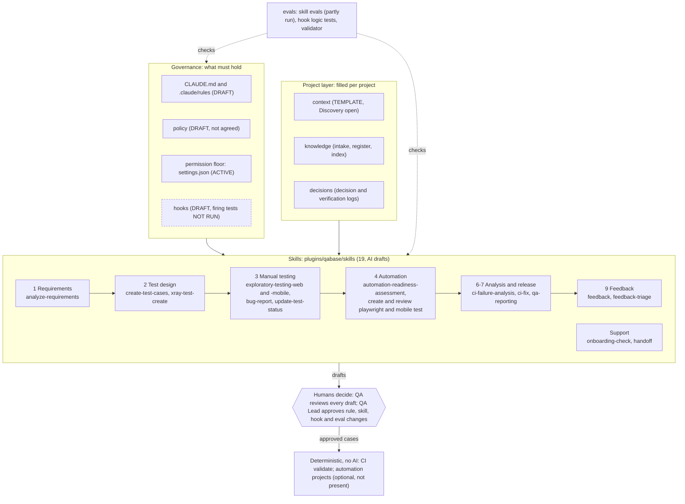

# AIQA STLC Concept

An AI-assisted QA process across the software lifecycle: from requirements to release, with a human deciding at every gate. It is both a portfolio project (what I designed and what I verified) and a base that can be implemented on a real project after Discovery.

STATUS: DRAFT v0.1. Nothing here is approved by anyone. Labels used throughout: VERIFIED FACT / EVIDENCE-SUPPORTED INFERENCE / ASSUMPTION / UNKNOWN.

**Author:** Oleksandr Kukhtinov, Senior Manual QA Engineer (13 years), AI-assisted QA. [LinkedIn](https://linkedin.com/in/akukhtinov)
I am a manual QA engineer, not an automation engineer. Claude Code generated the tooling from my specification; I designed the QA logic and verified the results. Generated code is not evidence of automation expertise, and I do not list Selenium, Playwright or Appium as my skills.

**Skills and provenance.** The skills here are analogues of my working implementation of skills, not that implementation. Some were copied or adapted from an earlier version (analyze-requirements, create-test-cases, create-playwright-test, review-playwright-test, create-mobile-test); each skill's origin is stated in its SKILL.md STATUS line and, where present, its PROVENANCE.md. This is the author's statement (ASSUMPTION): the working implementation is not in this repository and cannot be checked here.

## The repository at a glance

Reading it: governance and the project layer feed the skills; the skills produce drafts; a person decides at every gate; what runs in CI is deterministic. The dashed box is not counted as a control yet. Drawn by hand from the files, 2026-11-11 (ai-generated; human-confirmed: pending); the state of each part is in the Map below, the stages and gates in [`docs/CONCEPT.md`](docs/CONCEPT.md).

## For a reviewer: five minutes

1. [`portfolio/`](portfolio/): the one-page summary and the 14-slide case study (anonymized: client, internal domains and channel names replaced).
2. [`CLAUDE.md`](CLAUDE.md) and [`.claude/rules/`](.claude/rules/): the working rules (evidence labels, verdicts, no production, human approval).
3. [`plugins/qabase/skills/`](plugins/qabase/skills/): the skills; 17 of 19 have written evals (the two exploratory-testing skeletons do not).
4. [`evals/`](evals/): how a skill, hook or agent is allowed to be called "working".

## Jira and test management: through skills

| Task | Skill | What it does | State |
|---|---|---|---|
| Bug ticket | `bug-report` | Builds a reproducible bug in the project's Jira fields, checks for duplicates, shows the draft. It creates the ticket through a Jira MCP connection only after the human confirms. | SKELETON v0.0.1. Evals written, NOT RUN. |
| Test cases | `create-test-cases` | Builds a coverage matrix from an approved requirement, designs the oracle separately, returns cases in the test management system's field structure for a human to review and save. | Evals written, NOT RUN. |

- VERIFIED FACT (files read 2026-10-23): no MCP server is connected in this repository (`.mcp.json` is empty), so nothing here talks to Jira or a test management system. The project's Jira fields and TMS structure are UNKNOWN until Discovery.
- VERIFIED FACT: the test-case skill only drafts; a person saves the cases. The bug skill is written to create one issue per human confirmation and to touch nothing else.
- In the earlier system described in the case study, creating test cases in the TMS was blocked by access (no API key) and creating bugs was blocked by a read-only connector. The author states that create and edit rights have since been granted (ASSUMPTION, not verified by a run). The skills still stop at a reviewed draft and a human confirmation, whatever the rights.

## The concept and worked examples

- [`docs/CONCEPT.md`](docs/CONCEPT.md): the stages, who decides, which skill helps, and what is proven.
- [`examples/demo-shop/`](examples/demo-shop/README.md): six worked stories (plus one optional) on a fictional e-commerce project. They are illustrations, not recorded runs; the one real piece is a dry run of the Xray script.
- [`training/materials/`](training/materials/model-harness-agent-glossary.md): example material for the course.

## How the lifecycle is covered

| Stage | Skill | State |
|---|---|---|
| Requirements | `analyze-requirements` | pilot |
| Test design | `create-test-cases` | draft, evals NOT RUN |
| Readiness for automation | `automation-readiness-assessment` | existing, evals NOT RUN |
| Automation (optional) | `create-playwright-test`, `review-playwright-test`, `create-mobile-test`, `review-mobile-test` | optional, mobile is DRAFT |
| Defects | `bug-report` | skeleton |
| Reports and CI | `qa-reporting`, `ci-failure-analysis`, `ci-fix` | skeleton, on hold |

## Map

| Path | What | State |
|---|---|---|
| `CLAUDE.md`, `.claude/rules/` | governance | DRAFT |
| `plugins/qabase/` | the plugin: skills with evals, contract template, hooks | DRAFT, evals partly run |
| `.claude-plugin/` | marketplace manifest for the qabase plugin | DRAFT |
| `tools/` | skill sync and index scripts, settings templates, git hooks | DRAFT |
| `docs/` | concept, setup, research, design schemes and specs | mixed; see each file |
| `docs/PLAN-next-steps.md` | next-steps plan for Codex and Claude: tasks, hard rules, open items | DRAFT, not approved by QA Lead |
| `.github/workflows/` | CI: runs `evals/validate_repo.py` | DRAFT |
| `.claude/hooks/`, `.claude/settings*.json` | hook scripts and settings | hooks: DRAFT; settings.json: ACTIVE, approved 2026-11-03 by QA Lead; settings.draft.json: DRAFT, full mirror of settings.json rules, not active |
| `evals/` | eval plan, hook tests, validator | partly runnable |
| `policy/` | AI usage and agents policy templates | DRAFT |
| `context/` | project context templates | TEMPLATE |
| `knowledge/` | intake process (`INTAKE.md`) and source register (`register.md`) | TEMPLATE |
| `knowledge/INDEX.md` | index of `docs/`, `context/`, `decisions/`, `knowledge/`: path, topic, tags, date, status | DRAFT, kept by hand |
| `automation/`, `ci/` | registry stubs | OPTIONAL, empty |
| `runs/` | run journal template; local eval-kit with recorded eval runs (git-ignored, not in the public repo) | template + recorded runs |
| `feedback/` | feedback loop: README and change proposals in `proposals/` | proposals exist |
| `decisions/` | decision log (D-001, D-002), verification log, conflicts register, one proposal | in use |
| `optional/` | agent layer (off by default), user-level mods | OPTIONAL |
| `training/` | a short course on working with an AI assistant in QA | OPTIONAL, lesson 1 only |
| `examples/demo-shop/` | worked stories on a fictional shop | ILLUSTRATIVE, not recorded runs |
| `portfolio/` | one-pager and case study | see its README |

## What is proven, and what is not

- VERIFIED FACT: `python3 evals/validate_repo.py` gives 668 passed, 0 failed locally and 262 passed, 0 failed in CI on a clean checkout (2026-11-03). It checks the structure of the files, not whether the assistant behaves well.
- VERIFIED FACT: hook logic tests passed 20/20 and 9/9 (2026-10-07).
- PARTLY RUN: skill evals (feedback-triage eval 2 PASS 3/3; analyze-requirements eval 6 PASS 3/3 after PR #8, with the reading of expectation 3 fixed by the owner after the first series; single model, 3 runs, no human spot-check of the grader). NOT RUN: create-test-cases, automation-readiness-assessment, feedback-triage evals 1, 3 and 4, hook firing tests in Claude Code. CI: validate runs on pull requests (passing on #9 to #11); it checks file structure only.
- UNKNOWN: the real project's tracker, TMS, environments and access (`context/discovery.md`).
- NOT VERIFIED: Jira/Xray skills (bug-report, xray-test-create, update-test-status) have never been run against a live tracker; no MCP server is connected.
- NOT VERIFIED: the web, mobile and API automation projects are not in this repository; statements about the author's mobile and web suites in the portfolio are the author's own, with no run log kept here, and the Windows PowerShell tooling of the earlier system is unverified.
- NOT VERIFIED: the case study's anonymization and the employer's permission to publish are the author's statements, not documented here.
- OPEN: verification items V-002 to V-005 in `decisions/verification-log.md`.
- NOT VERIFIED: claims taken from conference talks in the course material (for example context rot) were not checked by us.

## Working from a cloud session

Open the repository in a Claude Code cloud session and use the skills there. Setup, the Jira/Xray environment (token as a network secret, never as a variable), the connection check and the limits are in [`docs/CLOUD-SESSION.md`](docs/CLOUD-SESSION.md). NOT RUN: no cloud session has been started against this repository yet.

## License

MIT, see [`LICENSE`](LICENSE): Copyright (c) 2026 Oleksandr Kukhtinov. Exceptions:
- [`portfolio/`](portfolio/NOTICE.md): personal materials, all rights reserved, for viewing.
- `plugins/qabase/_base/manual-tester/` and `plugins/qabase/_base/exploratory-testing/`: donor skills by other authors, each under its own MIT `LICENSE` kept in its folder.
- Embedded fonts in the lesson files (IBM Plex Sans) keep their own licence (SIL OFL).
Third-party notices: [`THIRD-PARTY-NOTICES.md`](THIRD-PARTY-NOTICES.md).
This is a statement of the author's intent, not legal advice.

## Implementing on a project

Start with `docs/GETTING-STARTED.md`, then fill `context/discovery.md`. The core (rules, skills, hooks, evals) is reused unchanged; the project layer is filled per project. Work only against DEV or another approved non-production environment.
