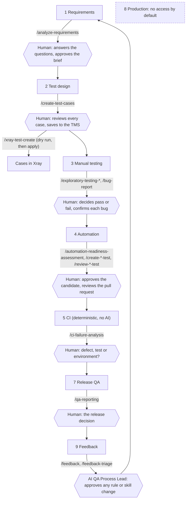

# AIQA STLC Concept

STATUS: DRAFT v0.1, 2026-10-23. A concept, not a product. Nothing here is approved by anyone; no skill has been evaluated in this repository (evals NOT RUN).

## The idea

AI speeds up QA reasoning: reading requirements, drafting test cases, judging what is worth automating, explaining failures. It does not decide. At every stage a person owns the decision, and anything that runs in CI or at release is deterministic code that works the day the AI is unavailable.

- **AI output is a draft, not evidence.** A claim that affects a decision carries a label: VERIFIED FACT, EVIDENCE-SUPPORTED INFERENCE, ASSUMPTION or UNKNOWN. Something not run is NOT TESTED, never PASS.
- **Automation is the result of a manual pass**, not a replacement for it. A test is written only for a case a person has already run.
- **The release decision is human.** The system produces a verdict with its limits (what was not tested, what capped the confidence), not a green light.

## The stages

Legend: rounded boxes are stages, hexagons are human gates, text on arrows is the skill that helps. Stage numbers follow `docs/schemes/11-sdlc-full.md`. Stage 6 (test analysis) is folded into the CI-failure gate here; stage 10 (the improvement loop) is the last gate.

## Who does what

| Stage | Skill (draft) | Human decision | State in this repository |
|---|---|---|---|
| 1 Requirements | `analyze-requirements` | answers the open questions; approves the brief | pilot; evals NOT RUN |
| 2 Test design | `create-test-cases`, `xray-test-create` | reviews each case (KEEP, MODIFY or REJECT); confirms project, plan hash and host before anything is written | DRAFT; Xray not connected |
| 3 Manual testing | `exploratory-testing-web`, `-mobile`, `bug-report`, `update-test-status` | pass or fail; confirms each bug draft | SKELETON, on hold |
| 4 Automation | `automation-readiness-assessment`, `create-playwright-test`, `review-playwright-test`, mobile pair | approves the candidate; reviews and merges | existing / DRAFT; mobile optional |
| 5 CI | none (deterministic) | none; reads the results | tool UNKNOWN |
| 6-7 Analysis and release | `ci-failure-analysis`, `ci-fix`, `qa-reporting` | classifies failures; makes the release decision | SKELETON, on hold |
| 8 Production | none | not applicable: production is prohibited | by rule |
| 9-10 Feedback and improvement | `feedback`, `feedback-triage` | approves every change to a rule, skill, hook or eval | DRAFT |

## Where the guarantees come from

- **Rules** (`CLAUDE.md`, `.claude/rules/`): always loaded; they say what must hold.
- **Permissions and hooks** (`tools/settings.*.json`, `.claude/hooks/`): they stop actions the model should not take. Hooks are DRAFT and their firing tests are NOT RUN, so they are not counted as a control yet.
- **Gates inside skills**: dry run before write, a plan hash, a confirmed host, a per-case review.
- **Evals** (`evals/`): a skill counts as working only after its evals ran.

## What is proven and what is not

- VERIFIED FACT (run 2026-10-23): `python3 evals/validate_repo.py` gives 229 passed, 0 failed. It checks the structure of the files, not whether an assistant behaves well.
- VERIFIED FACT: the script behind `xray-test-create` passes 10 offline unit tests (fake HTTP). It has never been run against a real Xray instance.
- NOT RUN: skill evals, hook firing tests, any CI, any cloud session.
- UNKNOWN: the tracker, the test management system, the environments and the access of a real project (`context/discovery.md`).

## See it in use

Six worked stories on a fictional e-commerce project, with the gates marked: [`examples/demo-shop/`](../examples/demo-shop/README.md). They are illustrations, not recorded runs.

To work with the skills from a cloud session: [`docs/CLOUD-SESSION.md`](CLOUD-SESSION.md). Governance and rollout: `docs/schemes/`.

Provenance: ai-generated, Sonnet 5.5, 2026-10-23; human-confirmed: pending.
