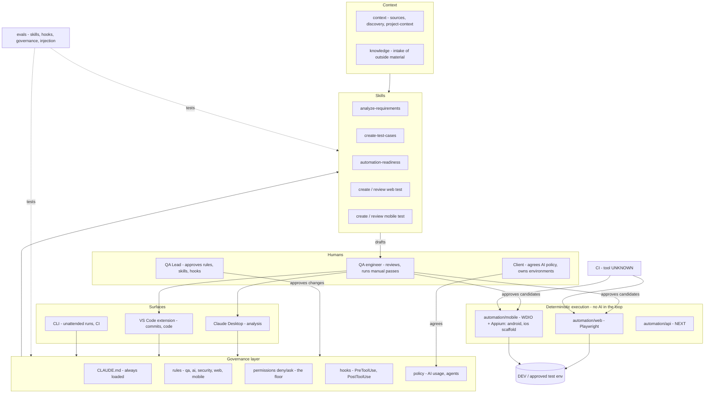

# 01 Architecture — layers and who owns what

STATUS: DRAFT scheme of the proposed design. Solid arrows = decided in this repo draft;
labels in brackets = status.

Reading it: AI works in the top half and produces drafts; humans approve; the bottom half
runs without AI. The governance layer sits between every surface and every skill.
