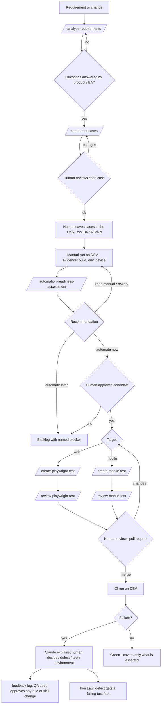
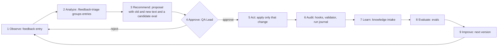

# 02 Workflow — one change from requirement to CI, with gates

STATUS: DRAFT. "Gate" = a human decision or an automated check that must pass before moving on.

Checks attached to the gates: skill evals (layer 1) for every skill box; hooks for secrets,
production and trusted-asset edits on every tool call; run journal (`QA-RUN.md`) for
manual and regression runs; verification log for any claim the flow relies on.

## The improvement loop: how the process itself changes

The flow above is one change to the product. This one is how a rule, skill, hook or eval of this
repository changes. Steps 1-4 and 8 exist today (`/feedback`, `/feedback-triage`, the approval model,
`evals/`). Audit and Learn have no skill of their own yet: audit is done by hooks, `evals/validate_repo.py`
and the run journal, learn by `knowledge/INTAKE.md`.

The same loop as a picture: [`docs/img/loop-map.svg`](../img/loop-map.svg), interactive version
[`docs/img/loop-map.html`](../img/loop-map.html). A person decides only at step 4; everything before it is a draft.
