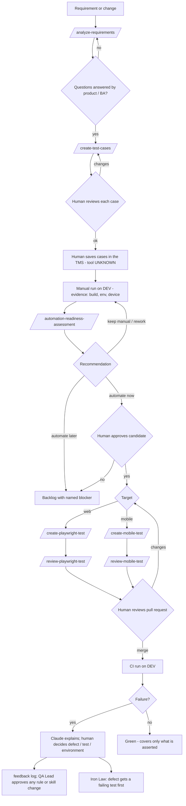

# 02 Workflow — one change from requirement to CI, with gates

STATUS: DRAFT. "Gate" = a human decision or an automated check that must pass before moving on.

Checks attached to the gates: skill evals (layer 1) for every skill box; hooks for secrets,
production and trusted-asset edits on every tool call; run journal (`QA-RUN.md`) for
manual and regression runs; verification log for any claim the flow relies on.
