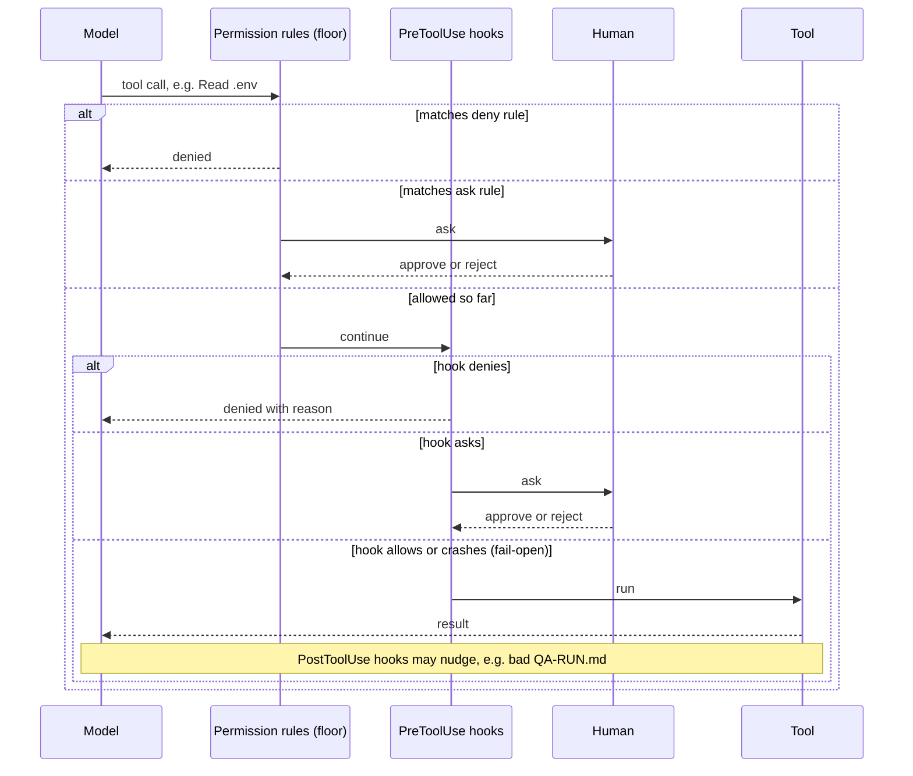

# 03 Enforcement — what stops a bad action

STATUS: DRAFT. Whether Claude Code behaves exactly like this on the client's machines is
OPEN until the hook firing tests pass (`evals/hooks-firing.md`). Do not describe hooks as active controls before they pass.

Why a floor: hooks fail open on errors, and `@` file references bypass PreToolUse, so
anything that must never happen is also a permission rule. Why advisory PostToolUse: it can
nudge the model back, it cannot undo what already ran.
