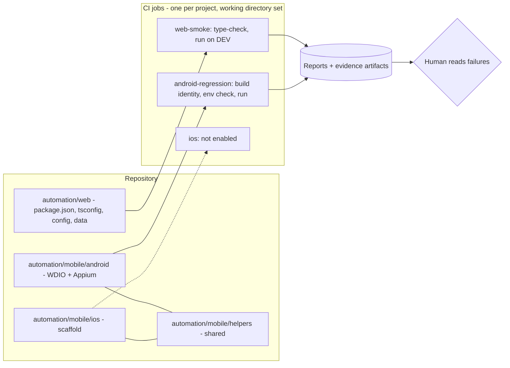

# 04 Automation projects and CI

STATUS: DRAFT. CI tool UNKNOWN until Discovery.
Projects are NOT PORTED yet.

Rules shown: each project self-contained; CI needs no AI to run; the mobile job fails if the
environment check is missing; the iOS job is off until its check passes (record it in `decisions/verification-log.md`); evidence artifacts may
contain client data and follow `ai-usage-policy.md` item 12.
