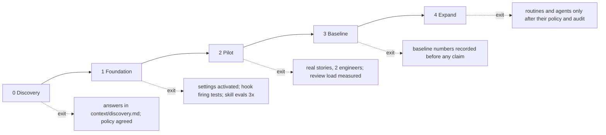

# 05 Rollout — phases and exit checks

STATUS: DRAFT. No dates: the start depends on confirmation of the return (Discovery item 1).

| Phase | Work | Check that ends it |
|---|---|---|
| 0 Discovery | fill `context/discovery.md`, agree `policy/`, get repo access | every item answered with a source, or accepted as UNKNOWN by the owner of decisions |
| 1 Foundation | port web + Android, activate settings in a throwaway copy, run firing tests and skill evals | the open checks in `decisions/verification-log.md` PASS or recorded FAIL |
| 2 Pilot | use the loop on real stories | acceptance and rewrite rates recorded; review time per item recorded |
| 3 Baseline | measure before claiming anything | numbers exist |
| 4 Expand | routines, CI integration, agents, API automation | each passes policy, audit, acceptance tests |
