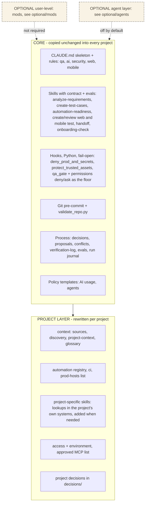
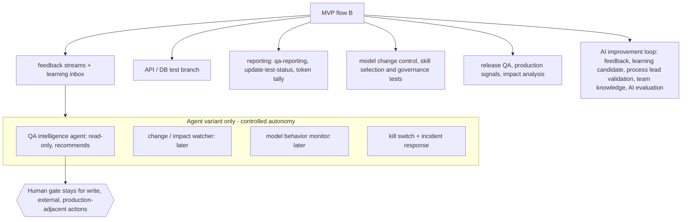

# 07 Base and variants — the reusable base

STATUS: WORKING DRAFT. Not the final diagram. One base, three layers. The base = CORE + PROJECT layer, with humans at every gate. An agent variant = the same base + the optional agent layer (`optional/agents/`). Nothing in the agent layer is enabled in this base (`policy/agents-policy.md`). Statuses in brackets are not verified.

## A. Layers (no agent layer by default; see D for the agent variant)

## B. MVP flow (humans at every gate, no agents)

```mermaid
flowchart LR
  R[Requirement] --> AR[analyze-requirements]
  AR --> BR{{Human approves brief}}
  BR --> TC[create-test-cases + AC trace]
  TC --> H1{{Human reviews cases}}
  H1 --> RD[automation-readiness]
  RD --> H2{{Human approves candidate}}
  H2 --> CT[create web / mobile test]
  CT --> RV[review test + weak-assertion check]
  RV --> H3{{Human reviews diff, merges}}
  H3 --> CI[CI: deterministic run, no AI]
  CI --> FA[ci-failure-analysis]
  FA --> H4{{Human decides: defect / test / env}}
  MT[Manual testing in parallel: functional, regression, exploratory, UI/UX] --> RD2{{Human: release decision}}
  H4 --> RD2
  RD2 --> FB[feedback log]
  FB --> H5{{AI QA Process Lead approves rule or skill change}}
```

## C. Full implementation (adds on top of MVP)

Source check: the stages and gates were compared with an architecture slide set (not included in this base). Its slide about tool roles (CLI / Desktop / VS Code, QA Lead / Middle / Junior duties, repository tree) is not drawn here.

## E. Agents in the full design -> what this base has instead (skills, human-triggered)

| Agent in the full design | This base | Note |
|---|---|---|
| QA Intelligence Agent (test health, failure patterns, release summary, recommendations) | skills `ci-failure-analysis`, `qa-reporting` | read and recommend; a human triggers and decides |
| Change / Impact Watcher | none; a project may add a repository-digest skill | manual only, never scheduled; the human asks |
| Model Behavior Monitor | none yet; `evals/` (skill selection, governance, injection) and the model/effort table | manual runs; no monitor |
| AI Evaluation (behavioral regression, acceptance tests) | `evals/` run by a person; grader in a separate session | not run yet |
| Sub-agents (`.claude/agents/`) | none | `policy/agents-policy.md`; off by default |
| Triggers, scheduled runs | none | every run starts from a person |

## D. What differs between the base and an agent variant

| Part | Base | Agent variant |
|---|---|---|
| Core | same | same |
| Project layer | template, filled per project | same |
| Agents | off; skills + human gates | allowed, per agent file, by maturity ladder (`optional/agents/`) |
| Critical actions (prod writes, privilege, governance) | never automatic | never automatic |
| Mods | optional, user level | optional, user level |
