# 08 MVP chain — humans, Claude, deterministic steps

STATUS: WORKING DRAFT. Not final. This base has skills and humans at gates, no autonomous agents. Statuses are from the repo state, not from a run.

Source: an MVP slide (not included in this base). Legend: C = Claude with a skill, H = human gate, D = deterministic (no AI).

```mermaid
flowchart LR
  R[Requirement] --> C1["C: analyze-requirements + brief"]
  C1 --> H1{{"H: review, approve brief"}}
  H1 --> C2["C: create-test-cases"]
  C2 --> H2{{"H: review cases, save to TMS"}}
  H2 --> C3["C: automation-readiness"]
  C3 --> H3{{"H: approve candidate"}}
  H3 --> C4["C: create web / mobile test"]
  C4 --> C5["C: review test"]
  C5 --> H4{{"H: review diff, merge"}}
  H4 --> D1["D: test code in repo"]
  D1 --> D2["D: independent CI run"]
  D2 --> D3["D: results, evidence"]
  D3 --> C6["C: ci-failure-analysis, when useful"]
  C6 --> H5{{"H: release decision"}}
  H5 --> FB[feedback log]
  M1["Manual testing, first-class: functional, regression, exploratory, UI/UX"] --> M2["Results, defects"]
  M2 --> H5
```

Parallel track: current sprint -> new functional cases -> Claude + Playwright -> validated automation -> future regression coverage (same chain as above, run per sprint).

## MVP scope: the design vs this base
| Component | Design | This base |
|---|---|---|
| Rules | 4 groups: QA, AI, Playwright, Security | qa, ai, security + web and mobile scoped |
| Skills | 5 core | 5 core + mobile pair + 11 more (many SKELETON); evals NOT RUN |
| Test cases | TMS is the source of truth | the project's own TMS (UNKNOWN until Discovery); access list in `docs/REQUIRED-ACCESS-AND-ENVIRONMENT.md` |
| Sub-agents | none in MVP | none |
| Evaluation | known-good baseline + acceptance checks + approval | `evals/` written, NOT RUN in this base |
| Feedback | central log, Learning Inbox next | skills `feedback` and `feedback-triage`; `feedback/` stub |
