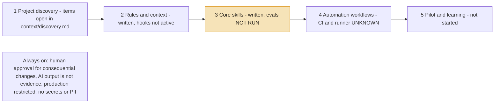

# 09 MVP implementation plan — five stages

STATUS: WORKING DRAFT. Not final. This base has skills and humans at gates, no autonomous agents. Statuses are from the repo state, not from a run.

Source: an MVP implementation-plan slide (not included in this base). Statuses are the repo state on 2026-10-20.

| Stage | Design says | This base | Evidence / gap |
|---|---|---|---|
| 1 Discovery | audit: CONFIRMED / TARGET / UNKNOWN / SEC GATE; source-of-truth matrix | `context/discovery.md`, all items open | no project repository or environment yet |
| 2 Rules and context | compact CLAUDE.md; rules QA, AI, Playwright, Security; `context/sources.md` | CLAUDE.md 98 lines, rules in `.claude/rules/` | hooks and deny rules inactive until `tools/apply-trusted-changes.sh` is run (not verified) |
| 3 Core skills | 5 core skills | written (plugin 0.1.0) | `evals/` NOT RUN in this base |
| 4 Automation workflows | sprint: readiness -> approval -> Claude + Playwright -> review -> PR -> CI; CI failure -> analysis; regression: readiness -> cleanup | skills exist; CI tool UNKNOWN; web and mobile projects not present | fill per project |
| 5 Pilot and learning | onboarding -> real sprint pilot; single feedback log; QA Lead review | `onboarding-check` written; `feedback/` stub | baseline before measurement (not taken) |

Metrics per slide: stage 3 output acceptance and major rewrite rate; stage 4 implementation time and pass / flaky rate; stage 5 baseline first, manual effort saved. No targets promised.
