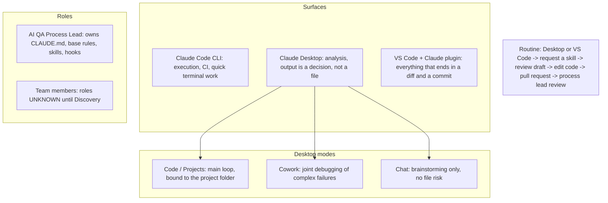

# 10 Tooling and team roles

STATUS: WORKING DRAFT. Not final. This base has skills and humans at gates, no autonomous agents. Statuses are from the repo state, not from a run.

Source: an architecture slide about tools and roles (not included in this base). Roles of Middle and Junior QA come from that design; for a project the team roles are UNKNOWN until Discovery.

Open for a project: does Desktop Code read `.claude/` like the CLI; is VS Code allowed on the employer's or client's machines; who reviews pull requests (team AQA or SDET, not confirmed). The repository tree on the slide (`qa-ai/`, `playwright/`) differs from this base (`automation/web`, `automation/mobile`).
