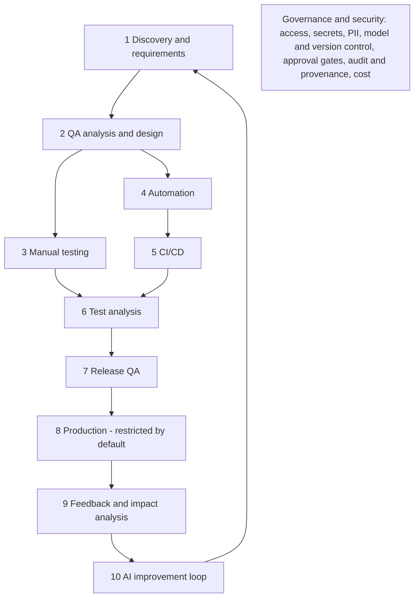

# 11 Full SDLC — ten stages mapped to skills

STATUS: WORKING DRAFT. Not final. This base has skills and humans at gates, no autonomous agents. Statuses are from the repo state, not from a run.

Source: an SDLC slide (not included in this base) and an architecture document, section 2. Where the design has an agent, this base has a human-triggered skill (see 07, section E).

| Stage | Skills / assets | Human gate |
|---|---|---|
| 1 | analyze-requirements (brief) | approve brief |
| 2 | create-test-cases, xray-test-create (dry run first; writes Test issues to Xray Server/DC) | review cases, save to TMS; confirm project, plan hash and host before any write |
| 3 | exploratory-testing-web / mobile, bug-report (creates one Jira issue through the Jira MCP after confirmation), update-test-status | tester decides pass / fail; confirms each bug draft |
| 4 | automation-readiness-assessment, create / review web and mobile test, ci-fix | approve candidate, merge |
| 5 | CI (tool UNKNOWN); deterministic, no AI | none; reads results |
| 6 | ci-failure-analysis; project-specific lookup skills (sector `investigation`, empty in this base) | decide defect / test / environment |
| 7 | qa-reporting; regression scope from the project's change data | release decision is human; no release skill |
| 8 | none; no production access | not applicable |
| 9 | feedback log (`feedback`, `feedback-triage`) | triage |
| 10 | feedback/, training/, handoff for session continuity | AI QA Process Lead approves any rule or skill change |
