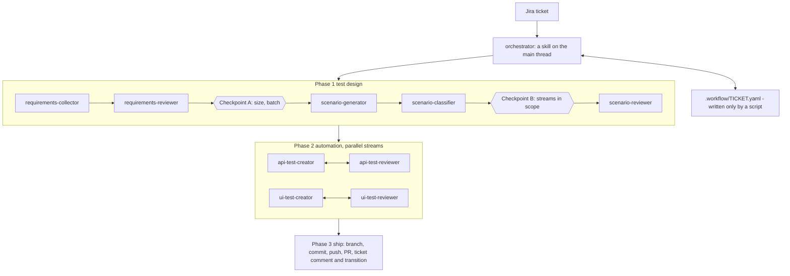

# Agent pattern reference (example)

STATUS: WORKING DRAFT. Not final. This base has skills and humans at gates, no autonomous agents. Statuses are from the repo state, not from a run.

Source: three slides of unknown origin, redrawn here as a diagram; the slides are not included. Treat it as a third-party example, not as a design of this base. This base does not use it (agents off, `policy/agents-policy.md`). Kept as input for anyone who adds agents (`optional/agents/README.md`).

Patterns worth reusing (when agents are added):
- one agent, one job, one tool grant; no agent names another;
- hand-over is file paths, never a chat log; each agent re-reads from disk and starts cold;
- one state file per run, written only by a script;
- creator and reviewer are separate agents, the rule you write against is the rule you are reviewed against;
- shared rules are read by path (etalons, contracts, references).
Already similar in this base: `runs/<id>/` files, brief and handoff files, review skills separate from create skills.
